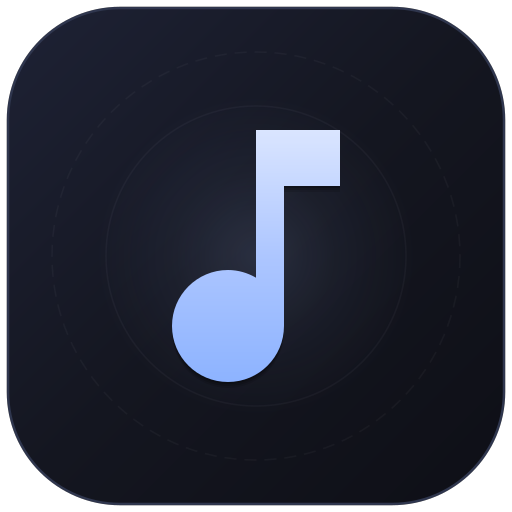

<p align="center">
  
</p>

<h1 align="center">Omniplay</h1>

<p align="center">
  <strong>Fast, modern, audiophile-grade local music player for Android with lossless audio & OmniSync™ multi-device streaming.</strong>
</p>

<p align="center">
  <a href="https://github.com/mininxd/omniplay/releases/latest"></a>
  
  
  
  <a href="LICENSE"></a>
</p>

---

Omniplay is an open-source Android music player crafted with Material 3 expressive design and audiophile-grade audio capabilities. It delivers direct 32-bit float rendering, bit-perfect USB DAC playback, native DSD playback, interactive gesture controls, synchronized lyrics, and **OmniSync™**—zero-configuration local multi-device audio broadcasting.

---

## ⚡ Highlights & Features

### 🎧 Audiophile Audio Engine & Hi-Res Fidelity
- **Jetpack Media3 (ExoPlayer)**: Powered by a modern, ultra-reliable playback pipeline.
- **Direct 32-Bit Float Processing**: Hardware-accelerated 32-bit floating-point audio output pipeline for pristine dynamic range without truncation artifacts.
- **Bit-Perfect Playback**: Automatic bit-perfect output detection and direct audio attributes routing for external USB DACs (Android 14+).
- **Native DSD Playback**: Custom direct decoding and decimation engine for Direct Stream Digital files (`.dsf`, `.dff`, DSD64, DSD128, DSD256).
- **Broad Format Support**:
  - **Lossless & Hi-Res**: FLAC, WAV, ALAC, AIFF, APE, WV, DSD/DSF/DFF.
  - **Lossy**: MP3, AAC, M4A, OGG, OPUS.
- **Direct Stream Header Inspection**: Instant, zero-overhead extraction of exact bit depth, sample rate, and bitrates directly from file headers.
- **Audio Fidelity Badges & Inspector**: Live format (FLAC, DSD, WAV, MP3), resolution (e.g. `24bit/96kHz`), Hi-Res, and Bit-Perfect badges, plus a detailed Track Details modal showing the active audio route, device pipeline, and hardware AudioTrack configuration.

---

### 📡 OmniSync™ Local Multi-Device Audio Streaming
- **Zero-Config P2P Streaming**: Broadcast music across nearby Android devices over local Wi-Fi or mobile hotspots with mDNS / NSD auto-discovery and direct gateway probing.
- **Host Mode**: Broadcast your playing music with low-overhead, byte-range HTTP streaming and real-time event distribution.
- **Listener Mode**: Join a broadcast with one tap or via manual IP connection.
- **Ultra-Low Latency (10–60ms)**: Real-time RFC 6455 WebSocket sync channel with dynamic micro-drift correction (pitch-preserved tempo smoothing) eliminates lag and keeps all devices tightly locked together.
- **Hardware-Adaptive Rendering**: High Quality (utilizing device 32-bit float or native bit depth) and Low Quality (standard 16-bit PCM) adjust dynamically to each listener device's physical audio hardware.

---

### 🎤 Synchronized & Embedded Lyrics
- **Karaoke-Style Time-Synced Lyrics**: Smooth, line-by-line synchronized scrolling with active lyric highlighting.
- **Tap-to-Seek**: Tap any lyric line to jump playback directly to that position in the song.
- **Triple-Source Discovery**:
  - Embedded metadata extractor (ID3v2 USLT / SYLT, Vorbis Comments, MP4 metadata).
  - Automatic local `.lrc` file discovery in your music folders.
  - Online synchronized lyrics fetching via the [LRCLIB](https://lrclib.net) API.

---

### 🌊 Gestures & Android 13/14 Squiggly Waveform
- **Animated Squiggly Waveform (Android 13/14 Style)**: Flowing waveform progress bar that straightens into a smooth guide line when touched, featuring a floating timestamp bubble.
- **Interactive Album Art Peeking**:
  - Drag the album cover horizontally to peek at the previous or next track's title, artist, and artwork without interrupting the current song.
  - Accidental skip protection: release to snap back smoothly, or drag past 35% to switch songs seamlessly.
- **Ambient Pulse Highlight**: Navigating to a song via **Go to artist**, **Go to album**, or **Go to folders** scrolls directly to the track and gently pulses the background to make it instantly recognizable.

---

### 📑 Queue Management & Music Library
- **Slide-Up Queue Sheet**: Persistent, smooth sliding queue sheet.
- **Swipe-to-Remove**: Swipe right on any queue item to quickly remove it with clean, theme-aware animations.
- **Multi-Folder Manager**: Select multiple directories across internal storage and SD cards to scan and monitor.
- **Side Drawer Library Filters**: Filter your music collection instantly by Tracks, Artists, Albums, and Folders.
- **Sorting Options**: Sort by Title, Artist, Album, Date Added, Duration, and File Size in ascending or descending order.
- **Instant Search**: Real-time search across your entire song library.

---

### 🎬 Built-in Video Player
- Integrated Media3 video player (`VideoPlayerActivity`) supporting MP4, MKV, TS, and WebM.
- Gesture controls for screen brightness, volume, and seeking.
- Aspect ratio controls (Fit, Zoom, Fill) and audio track selection.

---

### 🎨 Material 3 Expressive Theming
- **Material You Dynamic Colors**: Extracts wallpaper color palettes automatically on Android 12+.
- **6 Dynamic Theme Styles**: Dynamic (System), Tonal Spot, Expressive, Fruit Salad, Monochrome, and Vibrant.
- **Theme Modes**: Full support for Light, Dark, and System-controlled theme modes.

---

### 🔄 In-App Updater
- Built-in update checker that checks directly against GitHub Releases.
- Displays full release notes rendered in Markdown and provides one-tap direct APK downloads.

---

## 📱 Downloads & Releases

Pre-compiled APKs are built automatically via GitHub Actions on every update:

| Flavor | Architecture | Minimum Version | Description |
| :--- | :--- | :--- | :--- |
| **`app_release.apk`** | `arm64-v8a`, `armeabi-v7a` | Android 8.0+ (API 26+) | Modern build with Material You dynamic color & full feature set. |
| **`app_release_legacy.apk`** | `arm64-v8a`, `armeabi-v7a` | Android 5.0+ (API 21+) | Legacy build with classic Material styling for older devices. |

📥 **[Download Latest APK Releases](https://github.com/mininxd/omniplay/releases/latest)**

---

## 🏗️ Technical Specifications

| Property | Details |
| :--- | :--- |
| **Language** | Kotlin (JVM Target 17) |
| **Compile SDK / Target SDK** | Android 15 (Compile SDK 35) / Android 14 (Target SDK 34) |
| **Minimum SDK** | Modern: API 26 (Android 8.0) • Legacy: API 21 (Android 5.0) |
| **Audio Framework** | AndroidX Media3 (ExoPlayer 1.4.1) |
| **Audio Pipelines** | Direct 32-bit Float AudioTrack, Bit-Perfect Direct Audio Attributes, Native DSD Decimator |
| **Network Protocols** | RFC 6455 WebSockets, HTTP Byte-Range Streaming, mDNS / DNS-SD |
| **Architecture** | Clean MVVM / Service Architecture with Kotlin Coroutines & Flow |

---

## 🛠️ Building From Source

### Prerequisites
- JDK 17
- Android SDK (API 35, Build Tools 34.0.0+)

### Build Steps
```bash
# Clone the repository
git clone https://github.com/mininxd/omniplay.git
cd omniplay

# Build release APKs (both Modern and Legacy flavors)
./gradlew assembleRelease
```

Generated APKs will be located in:
- `app/build/outputs/apk/modern/release/`
- `app/build/outputs/apk/legacy/release/`

---

## 📄 License

Omniplay is open-source software licensed under the **[Apache License 2.0](LICENSE)**.
